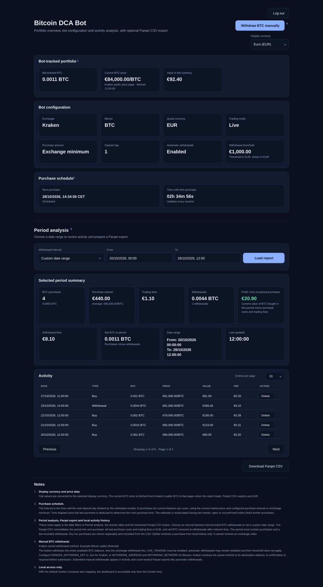

# DCA Crypto Bot for Bitvavo and Kraken

A Docker-based DCA bot for buying a configurable crypto asset with a selectable quote currency on Bitvavo or Kraken. Choose the exchange, crypto asset, quote currency, purchase amount, and deposit day. The bot recalculates purchase timing from the available balance and the selected exchange's current minimum order rules. A local web UI provides an activity and portfolio overview and can generate Parqet-compatible CSV exports.

### Example web UI (fictional data)

The image below is an illustrative screenshot with fictional values; it does not show real balances or activity.

## What you need

- An always-on server or host (for example, a VPS, home server, or NAS) running Docker Engine and the Docker Compose plugin
- An account at Bitvavo or Kraken
- API credentials for the exchange you select
- For automatic withdrawals: a verified Bitvavo withdrawal address, or a saved Bitcoin withdrawal method on Kraken

## 1. Choose your exchange and create an API key

Set `EXCHANGE` in docker-compose.yml to BITVAVO or KRAKEN. Create an API key for that same exchange and grant only the permissions listed below for the features you plan to use.

### Bitvavo

Create a key under **Settings → API**. Enable 2FA on your account.

- Required for balances and history: **View access**
- Required for live purchases: **Trade digital assets**
- Required only for automatic withdrawals: **Withdraw digital assets**

Copy the key and secret into `BITVAVO_API_KEY` and `BITVAVO_API_SECRET` in your local .env file. See Bitvavo's [API key setup guide](https://docs.bitvavo.com/docs/get-started/).

For withdrawals, add and verify the destination address in Bitvavo first. The bot uses `WITHDRAW_ADDRESS` and `WITHDRAW_NETWORK`.

### Kraken

Create a **Spot API key**. Enable the permissions needed for the bot's features:

- Required for balances and bot-order fill details: **Query Funds** and **Query Closed Orders & Trades**
- Required for live purchases: **Modify Orders**
- Required only for automatic withdrawals: **Withdraw Funds**

Copy the key and secret into `KRAKEN_API_KEY` and `KRAKEN_API_SECRET` in your local .env file. See Kraken's [API key guide](https://support.kraken.com/in/articles/360000919966-how-to-create-an-api-key?mode=consumerapp).

For withdrawals, first add a Bitcoin withdrawal method in Kraken. Set its saved method name in `KRAKEN_WITHDRAW_KEY` in your local .env file. This is the saved method name, not the wallet address.

Kraken's withdrawal endpoints currently used by the bot are marked as legacy. Kraken says they remain active and recommends migrating to its newer Funding API. See the official [withdrawal endpoint documentation](https://docs.kraken.com/api-reference/funding/withdraw-funds).

## 2. Add your credentials

Copy the example file and fill in the credentials for the selected exchange:

~~~sh
cp .env.example .env
~~~

The web UI reads current prices from Kraken’s public [BTC/EUR](https://www.kraken.com/convert/btc/eur) and [BTC/USD](https://www.kraken.com/convert/btc/usd) converter pages. No API credentials are required; the Docker host must have internet access.

For Bitvavo, fill in `BITVAVO_API_KEY` and `BITVAVO_API_SECRET`. For Kraken, fill in `KRAKEN_API_KEY` and `KRAKEN_API_SECRET`. Leave the other exchange's credentials empty. Never commit .env or API credentials to the repository.

`WEB_UI_PORT`, exchange API credentials, and (for Kraken withdrawals) `KRAKEN_WITHDRAW_KEY` are set in .env. The other bot settings are configured directly in docker-compose.yml, including Bitvavo's `WITHDRAW_ADDRESS` and `WITHDRAW_NETWORK`.

## 3. Configure the bot

Choose `EXCHANGE` in docker-compose.yml. Only credentials for that exchange are required; variables for the other exchange may stay empty. The adapters validate credentials only for the selected exchange.

Keep `LIVE_TRADING` set to `false` for the initial startup. The common settings below go in docker-compose.yml.

### Common settings

| Setting | Default | Description |
| --- | --- | --- |
| `EXCHANGE` | `KRAKEN` | Exchange to use: `BITVAVO` or `KRAKEN`. |
| `QUOTE_CURRENCY` | `EUR` | Fiat or quote currency for deposits and the BTC market. For the web UI display currency conversion, use `EUR` or `USD`; the selected exchange must support that currency and market. |
| `BASE_ASSET` | `BTC` | Asset to buy. The market is formed as `BASE_ASSET-QUOTE_CURRENCY`. |
| `BUY_AMOUNT` | `0` | Desired BTC amount per purchase. `0` uses the smallest amount currently allowed by the selected exchange's market rules; these rules are fetched dynamically on every execution. |
| `DEPOSIT_DAY` | `1` | Day of the month that starts a new DCA scheduling period. If a month is shorter, its final day is used. |
| `FIRST_BUY_DELAY_SECONDS` | `60` | Seconds the bot waits after every container startup before checking purchase history or calculating the first order. After the wait, if a prior real purchase exists, the bot recalculates the DCA interval and subtracts the time elapsed since that purchase to preserve the cadence. |
| `TIMEZONE` | `Europe/Berlin` | Time zone used to calculate the deposit-cycle boundary. |
| `LIVE_TRADING` | `false` | Set to `true` to submit real orders. Keep `false` to run in dry-run mode. |
| `CHECK_INTERVAL_SECONDS` | `300` | Retry delay when a purchase cannot proceed, for example because funds are insufficient or the market is unavailable. Values below 60 are raised to 60 seconds. |
| `WITHDRAWALS_ENABLED` | `false` | Enables automatic Bitcoin withdrawals. Also requires `LIVE_TRADING=true`. |
| `WITHDRAW_THRESHOLD_QUOTE` | `1000` | Withdraw when the available BTC balance reaches this value in `QUOTE_CURRENCY`. |
| `WEB_UI_ENABLED` | `true` | Enables the local portfolio dashboard. |
| `LOG_LEVEL` | `INFO` | Python log level, such as `INFO`, `WARNING`, or `DEBUG`. |

### Bitvavo settings

These variables are used only when `EXCHANGE=BITVAVO`. Put the API key and secret in .env. Set the withdrawal address and network in docker-compose.yml only if Bitvavo withdrawals are enabled.

| Variable | Required when | Description |
| --- | --- | --- |
| `BITVAVO_API_KEY` | `EXCHANGE=BITVAVO` | Bitvavo API key in .env. |
| `BITVAVO_API_SECRET` | `EXCHANGE=BITVAVO` | Bitvavo API secret in .env. |
| `WITHDRAW_ADDRESS` | Bitvavo withdrawals enabled | Verified Bitvavo Bitcoin destination address in docker-compose.yml. |
| `WITHDRAW_NETWORK` | Bitvavo withdrawals enabled | Bitvavo withdrawal network in docker-compose.yml. |

### Kraken settings

These variables are used only when `EXCHANGE=KRAKEN`. Put the API key and secret in .env. The withdrawal method name is required only if Kraken withdrawals are enabled.

| Variable | Required when | Description |
| --- | --- | --- |
| `KRAKEN_API_KEY` | `EXCHANGE=KRAKEN` | Kraken API key in .env. |
| `KRAKEN_API_SECRET` | `EXCHANGE=KRAKEN` | Kraken API secret in .env. |
| `KRAKEN_WITHDRAW_KEY` | Kraken withdrawals enabled | Name of the saved Bitcoin withdrawal method in Kraken; set it in .env. |

### Web UI port

Set `WEB_UI_PORT` in .env to change the default port from 6890. Compose uses it for both the host and container port. The dashboard remains bound to the local host only.

## 4. Start with dry-run mode

Start the container and follow its logs:

~~~sh
docker compose up -d --build
docker compose logs -f
~~~

The dashboard is available at [http://localhost:6890](http://localhost:6890) by default. It is bound to the Docker host's loopback address, so it is not exposed to the home network or the public internet. If you set `WEB_UI_PORT` in .env, use that port in the address.

When you are ready to place real orders, set `LIVE_TRADING` to true in docker-compose.yml and recreate the container:

~~~sh
docker compose up -d --build
~~~

## How the purchase schedule works

- Before each purchase check, the bot reads the current available `QUOTE_CURRENCY` balance on the selected exchange. Existing funds are included, even if they were deposited before the current scheduling period.
- Before each purchase, the bot fetches the selected market's current rules and price. The effective BTC order amount is the larger of `BUY_AMOUNT` and the minimum amount required by the exchange's minimum BTC quantity and minimum order value. If `BUY_AMOUNT` is zero or below that minimum, the exchange minimum is used; if it is above the minimum, the configured amount is used.
- To estimate how many purchases remain until the next `DEPOSIT_DAY`, the bot divides the available balance by the quote-currency value of that effective order amount.
- On every startup, the bot first waits `FIRST_BUY_DELAY_SECONDS`, then checks the persistent activity volume for the most recent real purchase of the configured asset. If there is none, it checks the first purchase immediately after the delay. If a previous purchase exists, it recalculates the interval from the current balance, market price, and next deposit day, then subtracts the time elapsed since that purchase (including the startup delay). It waits only for the remaining interval, or buys immediately if the interval has already elapsed. After that first purchase, the existing schedule continues: the bot records each purchase, refreshes balance and BTC price, recalculates the next interval, and waits until its estimated local purchase time. The log entry `Recalculated DCA schedule` shows the values used. `CHECK_INTERVAL_SECONDS` is used for retries when a purchase cannot proceed.
- The schedule does not depend on finding a completed deposit record for the current period. In dry-run mode, simulated purchases appear in the web UI, are marked as simulated, and are subtracted from the balance for scheduling. Their fee is estimated from the selected exchange's current taker fee tier; simulated records are excluded from Parqet CSV exports.
- Market orders do not guarantee an execution price. A configured `BUY_AMOUNT` can cost more or less than estimated as the market price changes.

## Automatic Bitcoin withdrawals

Automatic withdrawals are disabled by default. To enable them, set `WITHDRAWALS_ENABLED` to true and `LIVE_TRADING` to true.

The bot checks the available BTC balance and its value in `QUOTE_CURRENCY`. When the value reaches `WITHDRAW_THRESHOLD_QUOTE`, it requests the available BTC balance less the withdrawal fee.

| Exchange | Withdrawal setup |
| --- | --- |
| Bitvavo | Set `WITHDRAW_ADDRESS` and `WITHDRAW_NETWORK`. The address must already be added and verified in your Bitvavo account. The API key also needs Withdraw digital assets permission. |
| Kraken | Add a Bitcoin withdrawal method in Kraken and set its saved method name as `KRAKEN_WITHDRAW_KEY`. The API key needs Withdraw Funds permission. |

Check the destination and network carefully before enabling automatic withdrawals. If a Kraken withdrawal request has an ambiguous response, the bot does not send it again automatically. Check the withdrawal status in Kraken before taking further action.

## Portfolio web UI

The dashboard displays purchases and withdrawals recorded when this bot places them. Select EUR or USD as the display currency; the page fetches current BTC prices in EUR and USD from Kraken’s public converter pages on load and converts historical fiat totals and fees using the same current price ratio. The displayed portfolio value is bot-tracked BTC multiplied by the selected live price. Its activity history is stored in `activity.json` and the dashboard snapshot in `dashboard.json` on the Docker-managed named volume `bitcoin-dca-webui-data`. Docker Compose creates and reattaches this same volume on redeploy. On first startup after updating, previously stored activity files under `./state` are copied into the named volume. Keep the volume when updating; `docker compose down -v` deletes it. The dashboard reads its activity and latest price snapshot from these local files; the web UI does not query Kraken or Bitvavo for transaction history. The displayed BTC amount is the net amount tracked from the bot's recorded purchases and withdrawals, not the full exchange-account balance.

Choose an interval between bot-recorded Bitcoin withdrawals or enter custom start and end dates. The activity table distinguishes simulated dry-run purchases from real purchases. Simulated fees are estimates based on your current exchange taker fee tier and are prefixed with `~`. Use **Delete** to remove an individual purchase from the local activity history; this does not reverse an order on the exchange. Download the selected period as a Parqet-compatible CSV for import into Parqet. Simulated purchases are excluded. Activity from before local tracking is enabled is not imported automatically. Set `WEB_UI_ENABLED` to false to disable the dashboard.

## Parqet CSV exports

The bot does not create Parqet CSV files automatically. To export, select a period in the web UI and click **Download Parqet CSV**. The file contains only purchases and withdrawals recorded from this bot, uses Parqet's semicolon-separated activity format, and can be imported with Parqet's [CSV activity import](https://faq.parqet.com/de/articles/870989-csv-import-aktivitaten-aus-einer-eigenen-csv-datei-importieren).

The local activity history starts when this version is deployed; earlier bot orders are not backfilled automatically. The export uses the saved transaction amounts, prices, and fees, so generating it does not query Kraken or Bitvavo for transaction history.

## Logs

The bot writes logs to the container's standard output and error streams. Each entry includes a timestamp, severity level, and message. The default level is `INFO`; change it with `LOG_LEVEL` in `docker-compose.yml`.

View live logs or inspect recent entries with:

~~~sh
docker compose logs -f
docker compose logs --tail=200
~~~

The logs include:

- **Startup configuration:** selected exchange and market, live or dry-run mode, quote currency, configured `BUY_AMOUNT` and whether the exchange minimum will be used, deposit day, startup delay, timezone, and retry interval.
- **Startup and purchase timing:** the wait for `FIRST_BUY_DELAY_SECONDS`, whether a previous real purchase was found in persistent activity, recalculated purchase interval, and estimated next purchase time in local time.
- **Schedule inputs:** available and spendable quote balance, current BTC price, effective order size and estimated quote cost, estimated number of possible buys, and next deposit date. These appear in the `Recalculated DCA schedule` entry.
- **Orders:** dry-run messages say what the bot would buy and confirm the simulated activity record. Live-order messages include the submitted amount, estimated cost, order status and exchange order ID, plus the number of activity records saved.
- **Withdrawals:** threshold checks, submitted BTC amount, estimated value, withdrawal ID, and warnings when a request's outcome needs checking.
- **Waiting and errors:** reasons a purchase cannot proceed, such as insufficient balance or a market that is not trading, along with exchange/API errors and reconciliation messages for unresolved orders.
- **Web UI requests:** HTTP requests to the local dashboard and its API endpoints.

For example, a `Recalculated DCA schedule` line tells you the balance and current market price used for the calculation, the estimated order size and cost, how many buys the balance could cover, and the calculated interval. A following `Next purchase` or restart-alignment line reports the wait and estimated local purchase time.

Logs may contain account balances, trade amounts, prices, and exchange order or withdrawal IDs. Review them before sharing publicly.

## Project structure and Docker files

The Docker and configuration files have different jobs:

- **Dockerfile** is the image build recipe. It installs Python dependencies and copies the bot and adapter code into the image.
- **docker-compose.yml** builds and runs that image, sets the bot's runtime options, and publishes the local web UI port.
- **.env.example** is a template for a local .env file. Use it for exchange API credentials, WEB_UI_PORT, and KRAKEN_WITHDRAW_KEY when needed. It is not a second Docker build file, and it contains no actual credentials by default.

The code is separated by responsibility:

- **bot.py** contains the exchange-independent DCA schedule, state handling, and bot workflow.
- **exchange.py** selects the configured exchange adapter.
- **bitvavo.py** and **kraken.py** implement the same exchange interface for their respective APIs.
- **reporting.py** converts trade and withdrawal data into Parqet CSV rows.
- **activity.py** stores bot-recorded activity and dashboard snapshots locally.
- **web_ui.py** serves the local dashboard and on-demand CSV download from the stored data.

## GitHub Container Registry

The workflow in .github/workflows/publish.yml builds and publishes the image to GHCR when changes are pushed to main, when version tags such as v1.0.0 are pushed, or when the workflow is started manually. Configure API credentials on the Docker host; credentials are not included in the image.

## Limitations

The bot supports BTC withdrawals and Parqet exports for Bitcoin activity. Exchange markets, deposit history, minimums, fees, and available fiat currencies differ. Confirm that the selected exchange supports your `QUOTE_CURRENCY` and BTC market before using live trading.

This project is a technical example, not investment advice.
