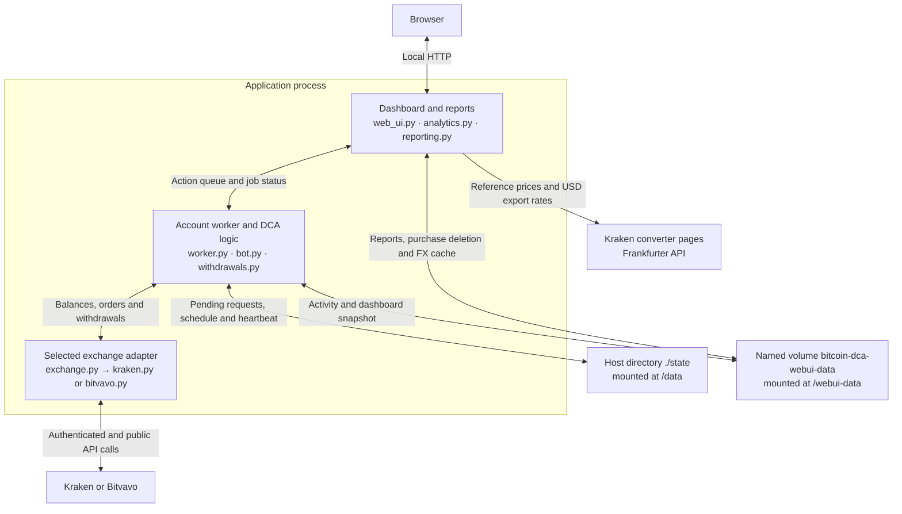

# Bitcoin DCA Bot for Bitvavo and Kraken

A Docker-based DCA bot for buying Bitcoin (BTC) on Bitvavo or Kraken, with optional Bitcoin withdrawals. Choose the exchange, quote currency, BTC purchase amount, and deposit day. The bot recalculates purchase timing from the available balance and the selected exchange's current minimum order rules. A local web UI provides an activity and portfolio overview and can generate Parqet-compatible CSV exports.

### Web UI screenshot (fictional data)

The screenshot below shows the upper part of the current dashboard, including its Bitcoin logo, bot configuration and the beginning of the purchase and withdrawal schedule. It was captured from the documentation preview with fictional data; the lower dashboard sections are outside this crop.

## What you need

- An always-on server or host (for example, a VPS, home server, or NAS) running Docker Engine and the Docker Compose plugin
- An account at Bitvavo or Kraken
- API credentials for the exchange you select
- For automatic or manual withdrawals: a verified Bitvavo withdrawal address, or a saved Bitcoin withdrawal method on Kraken

## 1. Choose your exchange and create an API key

Set `EXCHANGE` in docker-compose.yml to BITVAVO or KRAKEN. Create an API key for that same exchange and grant only the permissions listed below for the features you plan to use.

### Bitvavo

Create a key under **Settings → API**. Enable 2FA on your account.

- Required for balances and history: **View access**
- Required for live purchases: **Trade digital assets**
- Required for automatic or manual Bitcoin withdrawals: **Withdraw digital assets**

Copy the key and secret into `BITVAVO_API_KEY` and `BITVAVO_API_SECRET` in your local .env file. See Bitvavo's [API key setup guide](https://docs.bitvavo.com/docs/get-started/).

For withdrawals, add and verify the destination address in Bitvavo first, then set `WITHDRAW_ADDRESS` and `WITHDRAW_NETWORK` in .env.

### Kraken

Create a **Spot API key**. Enable the permissions needed for the bot's features:

- Required for balances and order-status verification: **Query Funds**, **Query Open Orders & Trades**, and **Query Closed Orders & Trades**
- Required for live purchases: **Modify Orders**
- Required for automatic or manual Bitcoin withdrawals: **Withdraw Funds**

Copy the key and secret into `KRAKEN_API_KEY` and `KRAKEN_API_SECRET` in your local .env file. See Kraken's [API key guide](https://support.kraken.com/in/articles/360000919966-how-to-create-an-api-key?mode=consumerapp).

For withdrawals, first add a Bitcoin withdrawal method in Kraken. Set its saved method name in `KRAKEN_WITHDRAW_KEY` in your local .env file. This is the saved method name, not the wallet address.

Kraken's withdrawal endpoints currently used by the bot are marked as legacy. Kraken says they remain active and recommends migrating to its newer Funding API. See the official [withdrawal endpoint documentation](https://docs.kraken.com/api-reference/funding/withdraw-funds).

## 2. Add your credentials

Copy the example file and fill in the credentials for the selected exchange:

~~~sh
cp .env.example .env
~~~

### Exchange API credentials

Fill in only the credentials for the exchange selected with `EXCHANGE`:

| Exchange | Variables in .env |
| --- | --- |
| Bitvavo | `BITVAVO_API_KEY` and `BITVAVO_API_SECRET` |
| Kraken | `KRAKEN_API_KEY` and `KRAKEN_API_SECRET` |

Leave the other exchange's credentials empty. Never commit .env or API credentials to the repository.

### Optional Bitcoin withdrawals

Set the destination details in .env if you plan to use automatic or manual Bitcoin withdrawals:

| Exchange | Variables in .env |
| --- | --- |
| Bitvavo | `WITHDRAW_ADDRESS` and `WITHDRAW_NETWORK` |
| Kraken | `KRAKEN_WITHDRAW_KEY` (the saved withdrawal method name) |

Enable automatic withdrawals and set their threshold with `WITHDRAWALS_ENABLED` and `WITHDRAW_THRESHOLD_QUOTE` in docker-compose.yml. See [Automatic Bitcoin withdrawals](#automatic-bitcoin-withdrawals) for the setup requirements.

### Web UI access

| .env variable | Default | Description |
| --- | --- | --- |
| `WEB_UI_PORT` | `6890` | Host and container port for the dashboard. |
| `WEB_UI_USERNAME` | `admin` | Username on the dashboard login page. |
| `WEB_UI_PASSWORD` | `admin` | Password on the dashboard login page. |

Change `WEB_UI_PASSWORD` before running the bot. The dashboard displays a styled login page and creates a 12-hour session after successful sign-in; the **Log out** button ends that session. By default, the port is published on all Docker host interfaces. Access it at `http://<docker-host-ip>:6890` from your network. HTTP does not encrypt sign-in credentials; use HTTPS through a reverse proxy on untrusted networks.

All other bot settings are configured directly in docker-compose.yml.

## 3. Configure the bot

Choose `EXCHANGE` in docker-compose.yml. Only credentials for that exchange are required; variables for the other exchange may stay empty. The adapters validate credentials only for the selected exchange.

Keep `LIVE_TRADING` set to `false` for the initial startup. The common settings below go in docker-compose.yml. Every purchase uses the `BTC-QUOTE_CURRENCY` market; Bitcoin is fixed and has no asset-selection setting.

### Common settings

| Setting | Default | Description |
| --- | --- | --- |
| `EXCHANGE` | `KRAKEN` | Exchange to use: `BITVAVO` or `KRAKEN`. |
| `QUOTE_CURRENCY` | `EUR` | Fiat or quote currency for deposits and the BTC market. For the web UI display currency conversion, use `EUR` or `USD`; the selected exchange must support that currency and market. |
| `BUY_AMOUNT` | `0` | Desired BTC amount per purchase. `0` uses the smallest amount currently allowed by the selected exchange's market rules; the selected market rules are refreshed during each account check and before the order decision. |
| `DEPOSIT_DAY` | `1` | Day of the month that starts a new DCA scheduling period. If a month is shorter, its final day is used. |
| `startup_delay_seconds` | `60` | Seconds the bot waits after every container startup before checking purchase history or calculating the first order. After the wait, if a prior real purchase exists, the bot recalculates the DCA interval and subtracts the time elapsed since that purchase to preserve the cadence. |
| `TIMEZONE` | `Europe/Berlin` | Time zone used to calculate the deposit-cycle boundary. |
| `LIVE_TRADING` | `false` | Set to `true` to submit real orders. Keep `false` to run in dry-run mode. |
| `CHECK_INTERVAL_SECONDS` | `300` | Target interval between account checks during a planned purchase wait; also the retry delay when a check fails. Running API calls and queued account actions can extend the elapsed time. Values below 60 are raised to 60 seconds. Checking the account does not itself place an order before the saved due time. |
| `ORDER_STATUS_CHECK_SECONDS` | `30` | Set in docker-compose.yml. Delay after a live-order submission before its first status check, and between subsequent checks while it is open or unresolved. Must be greater than zero; applies to both exchanges. |
| `WITHDRAWALS_ENABLED` | `false` | Enables automatic Bitcoin withdrawals. Also requires `LIVE_TRADING=true`. |
| `WITHDRAW_THRESHOLD_QUOTE` | `1000` | Withdraw when the available BTC balance reaches this value in `QUOTE_CURRENCY`. |
| `WEB_UI_ENABLED` | `true` | Enables the local portfolio dashboard. |
| `LOG_LEVEL` | `INFO` | Python log level, such as `INFO`, `WARNING`, or `DEBUG`. |

## 4. Start with dry-run mode

Start the container and follow its logs:

~~~sh
docker compose up -d --build
docker compose logs -f
~~~

The dashboard is available at [http://localhost:6890](http://localhost:6890) by default and prompts for `WEB_UI_USERNAME` and `WEB_UI_PASSWORD`. The default credentials are `admin` / `admin`; replace the password in .env before starting. The port is published on all Docker host interfaces, so other devices can use `http://<docker-host-ip>:6890` where permitted by the host firewall. If you set `WEB_UI_PORT` in .env, use that port in the address.

When you are ready to place real orders, set `LIVE_TRADING` to true in docker-compose.yml and recreate the container:

~~~sh
docker compose up -d --build
~~~

## How the purchase schedule works

- Before each purchase check, the bot reads the current available `QUOTE_CURRENCY` balance on the selected exchange. Existing funds are included, even if they were deposited before the current scheduling period.
- When quote funds are available and no order is awaiting confirmation, the bot refreshes the selected BTC market rules and reads its current price for the purchase decision. Stable pair identifiers may be reused, but order minimums and trading status are refreshed for the order decision. Only the selected market is requested. The effective BTC order amount is the larger of `BUY_AMOUNT` and the minimum amount required by the exchange's minimum BTC quantity and minimum order value. If `BUY_AMOUNT` is zero or below that minimum, the exchange minimum is used; if it is above the minimum, the configured amount is used.
- The purchase interval is the time from the last purchase to the next deposit date, divided by the number of purchases the current budget can cover. If no previous purchase exists, the current time is used as the starting point. Elapsed time since the last purchase reduces the remaining wait, not the interval’s starting point.
- To estimate how many purchases remain until the next `DEPOSIT_DAY`, the bot uses the effective order value plus the estimated taker fee and a 0.5% planning buffer, rounded up to the market’s quote precision. This buffer affects scheduling and affordability; it does not cap the execution price of a market order. Fee rates are cached for at most five minutes. Dry-run spending subtracts the purchase value and its simulated trading fee; the unused planning buffer is not recorded as a fee.
- On every startup, the bot waits `startup_delay_seconds`, then determines the last purchase time from recorded real Bitcoin purchases or, if none are recorded, from the saved execution state. If no previous purchase time is available, the first purchase is due after the startup delay, provided funds and market conditions allow it. Otherwise, the bot calculates the interval from that last purchase time to the next deposit date, using the current balance and estimated order cost to determine the number of possible purchases. The next purchase is scheduled at the last purchase time plus that interval; time already elapsed, including the startup delay, reduces the remaining wait. It stores the due time and the planning inputs. Periodic checks preserve that due time when funds, effective cost and deposit boundary are unchanged; changed inputs trigger a recalculation. It waits only for the remaining interval, or buys immediately if the interval has already elapsed. After that first purchase, the bot waits for each live order to reach a confirmed end status, records its fills, refreshes balance and BTC price, recalculates the next interval from the actual execution time, and waits until its estimated local purchase time. The log entry `Recalculated DCA schedule` shows the values used. `CHECK_INTERVAL_SECONDS` schedules periodic account checks independently of the next purchase time; ongoing exchange requests and queued actions can delay a check.
- The schedule does not depend on finding a completed deposit record for the current period. In dry-run mode, simulated purchases appear in the web UI, are marked as simulated, and are subtracted from the balance for scheduling. Their fee is estimated from the selected exchange's current taker fee tier; simulated records are excluded from Parqet CSV exports.

### Order verification

After each live-order submission, the bot waits `ORDER_STATUS_CHECK_SECONDS` before checking the order using its saved exchange order ID or client reference. It records confirmed fills only after the order has ended, then recalculates the next purchase from the actual execution time. Open and partially filled orders block new purchases and are checked again after the configured delay. A canceled or expired order with a partial fill records only the final executed amount.

A positively classified exchange rejection, such as insufficient funds or an invalid order minimum, clears the newly submitted pending request and returns to normal checks. Duplicate-reference errors, unknown errors and transport timeouts are not treated as proof of rejection. If submission times out, the bot does not submit another order: it looks up the existing request by its saved reference. An order that cannot be found or whose status remains unclear continues to block purchases, including after a restart. A confirmed terminal order with no fill is cleared without recording a purchase. This verification applies to Bitvavo and Kraken. Kraken's three short network retries are read retries; they never submit another purchase.

## Automatic Bitcoin withdrawals

Automatic withdrawals are disabled by default. To enable them, set `WITHDRAWALS_ENABLED` to true and `LIVE_TRADING` to true.

The worker checks the available BTC balance and its value in `QUOTE_CURRENCY`. When the value reaches `WITHDRAW_THRESHOLD_QUOTE`, it requests the available BTC balance less the withdrawal fee. A submitted withdrawal is tracked by its exchange identity or a unique destination/time/amount match; ambiguous matches are never accepted. Kraken `Success` and Bitvavo `completed` are treated as completed. Kraken `Settled` is still pending because it indicates a blockchain broadcast rather than confirmation. Failed withdrawals release the recorded debit. Submitted withdrawals block further automatic/manual withdrawals until their outcome is resolved. The account worker continues to check this state during purchase waits.

| Exchange | Withdrawal setup |
| --- | --- |
| Bitvavo | Set `WITHDRAWALS_ENABLED=true`, `WITHDRAW_ADDRESS`, and `WITHDRAW_NETWORK`. The address must already be added and verified in your Bitvavo account. The API key also needs Withdraw digital assets permission. |
| Kraken | Set `WITHDRAWALS_ENABLED=true`, then add a Bitcoin withdrawal method in Kraken and set its saved method name as `KRAKEN_WITHDRAW_KEY`. The API key needs Withdraw Funds permission. |

Check the destination and network carefully before enabling automatic withdrawals on either exchange. If a withdrawal request has an ambiguous response, retry behavior differs: Bitvavo may retry the identical request using the same idempotency key, while Kraken withdrawals are not retried automatically. For Kraken, check the withdrawal status in Kraken before taking further action. For Bitvavo, the idempotency key is intended to prevent duplicate withdrawals, but verify the status in Bitvavo before taking manual action.

Manual withdrawals are also available in the [web UI](#manual-bitcoin-withdrawals).

## Portfolio web UI

Set **Expected monthly deposit** in the exchange’s quote currency to estimate withdrawals beyond the current fiat balance. The assumption is saved in this browser and affects only the forecast. It adds funds on `DEPOSIT_DAY` and recalculates future purchase intervals using the current BTC price, order size and estimated costs including fees. Actual deposits, prices and execution can change the result.

Open [http://localhost:6890](http://localhost:6890) and sign in with the credentials from .env. The dashboard shows the bot-tracked BTC portfolio, configuration, next purchase time, and purchases and withdrawals with their current status.

- Select EUR or USD for display. Reference prices come from Kraken’s public [BTC/EUR](https://www.kraken.com/convert/btc/eur) and [BTC/USD](https://www.kraken.com/convert/btc/usd) pages; cached prices are labelled.
- Choose a withdrawal interval or custom dates in **Period analysis**, browse Activity, and download a [Parqet CSV](#parqet-csv-exports). Dry-run purchases are marked and excluded from exports.
- **Delete** removes a purchase from local history only; it never reverses an exchange order.

The portfolio covers bot-recorded activity, not the full exchange account. Data persists in the named volume `bitcoin-dca-webui-data`. Set `WEB_UI_ENABLED=false` to disable the dashboard.

### Manual Bitcoin withdrawals

Click **Withdraw BTC manually** below **Log out**, review the balance and destination, then confirm. This sends the entire available BTC balance less the exchange fee. Destination settings appear in Notes. Requires `LIVE_TRADING=true`, withdrawal permissions and a configured destination; the automatic-withdrawal toggle and threshold do not apply. Confirmation expires after two minutes. Submitted withdrawals appear in Activity and enter exports only after exchange confirmation.

## Parqet CSV exports

Select a date range in the web UI and click **Download Parqet CSV**. The export uses the last confirmed withdrawal in that range and the complete interval after its previous confirmed withdrawal, creating one consolidated **Buy** row for [Parqet’s CSV import](https://faq.parqet.com/de/articles/870989-csv-import-aktivitaten-aus-einer-eigenen-csv-datei-importieren):

- **Cost:** real purchases plus trading fees after the previous confirmed withdrawal and up to and including the ending withdrawal. USD costs are converted to EUR using historical daily reference rates.
- **BTC quantity:** net BTC from the ending confirmed withdrawal, after network fees.
- **Date:** the ending confirmed withdrawal.

The selected range must include a confirmed withdrawal, and its complete withdrawal interval must contain a real purchase. Simulations and unconfirmed or failed withdrawals are excluded. Fees are already reflected in the cost and net quantity; the CSV fee field is zero.

Purchases after the ending withdrawal are always excluded. A start date inside an interval is expanded back to the previous confirmed withdrawal; for the first withdrawal, all earlier recorded real purchases are included. If the range contains multiple withdrawals, only the last interval is exported. Re-exporting the same withdrawal can still duplicate activity in Parqet. See [Prices and Parqet exports](#prices-and-parqet-exports) for limitations.

## Architecture and operation

### Project structure and Docker files

The application runs in one Docker container. Its HTTP server and account worker share a Python process; the worker executes scheduled checks and queued manual withdrawals sequentially.

The named volume holds `activity.sqlite3` (activity and FX cache) and `dashboard.json`. The worker’s supervisor detects stopped or stalled execution; Docker runs `healthcheck.py` as a separate process to check the saved heartbeat.

`Dockerfile` builds the image. `docker-compose.yml` defines runtime settings, the local port, persistent mounts and restart policy. Copy `.env.example` to `.env` for credentials, withdrawal destinations and web UI access.

### Worker health and updating

Docker checks `/data/worker-health.json` every five minutes. The worker writes its heartbeat immediately on startup and then at most once every five minutes during normal operation; its stopped status is written immediately on exit. The file-based healthcheck accepts a running heartbeat less than 15 minutes old. Separately, the supervisor checks the in-memory worker heartbeat every ten seconds and exits the process for Docker’s existing restart policy if the worker stops or remains stalled for ten minutes. Saved pending orders and uncertain withdrawals are retained across restarts. The local `/healthz` route exposes only the worker health status. Health indicates that the worker is running, not that exchange requests are succeeding or that trading is possible. Ordinary API errors are logged and retried without making a responsive worker unhealthy. Docker marking a container unhealthy does not itself restart it; the supervisor exits the process for stalled or stopped workers, and `restart: unless-stopped` handles that exit.

Keep both persistent mounts when updating: `./state` contains pending requests and scheduling state; `bitcoin-dca-webui-data` contains `activity.sqlite3` and `dashboard.json`. Back up both before upgrading. On first database access, legacy `activity.json` is imported once into SQLite, preserving IDs and amounts and retaining the original JSON. Older withdrawals without a confirmed status remain excluded from exports until uniquely verified; see [Withdrawals and local records](#withdrawals-and-local-records). Reverting to a JSON-only release does not restore new SQLite activity to JSON. Do not use `docker compose down -v` during an update. Rebuild and recreate with `docker compose up -d --build` after updating the source checkout.

### Logs

The bot writes logs to the container's standard output and error streams. Each entry includes a timestamp, severity level, and message. The default level is `INFO`; change it with `LOG_LEVEL` in `docker-compose.yml`.

View live logs or inspect recent entries with:

~~~sh
docker compose logs -f
docker compose logs --tail=200
~~~

The logs include:

- **Startup configuration:** selected exchange and market, live or dry-run mode, quote currency, configured `BUY_AMOUNT` and whether the exchange minimum will be used, deposit day, startup delay, timezone, and retry interval.
- **Startup and purchase timing:** the wait for `startup_delay_seconds`, whether a previous real purchase was found in persistent activity, recalculated purchase interval, and estimated next purchase time in local time.
- **Schedule inputs:** available and spendable quote balance, current BTC price, effective order size and estimated quote cost, estimated number of possible buys, and next deposit date. These appear in the `Recalculated DCA schedule` entry.
- **Orders:** dry-run messages say what the bot would buy and confirm the simulated activity record. Live-order logs show submission and exchange order ID, the configured status-check delay, open or unresolved status checks, and confirmation of the final status and activity records saved.
- **Withdrawals:** threshold checks, submitted BTC amount, estimated value, withdrawal ID, and warnings when a request's outcome needs checking.
- **Waiting and errors:** reasons a purchase cannot proceed, such as insufficient balance or a market that is not trading, along with exchange/API errors and reconciliation messages for unresolved orders. Transient Kraken read failures include the endpoint, attempt count, and short retry delay in the logs.
- **Web UI requests:** HTTP requests to the local dashboard and its API endpoints.

For example, a `Recalculated DCA schedule` line tells you the balance and current market price used for the calculation, the estimated order size and cost, how many buys the balance could cover, and the calculated interval. After startup, `Startup history` reports the latest recorded real purchase. The subsequent `Restart alignment` INFO entry shows the purchase time, elapsed minutes including the startup delay, calculated interval, next purchase time with UTC offset, and remaining wait. It also states when an existing due time was retained for unchanged inputs. This alignment entry appears once per startup when sufficient funds and market data allow scheduling. Each subsequent successful scheduling check writes a `Purchase schedule` INFO entry with the last purchase, elapsed minutes, next purchase time and remaining minutes. It states whether the saved due time was retained or recalculated. The dashboard’s Purchase schedule panel shows the stored due time and countdown; a recalculation or alignment log alone does not mean an order was submitted.

Kraken balance, market-data, and other read-only queries use a 10-second connection timeout and a 30-second read timeout. The HTTP connection pool is renewed after 60 seconds without a request, so a later purchase does not reuse connections left idle throughout the wait. A timeout or connection failure discards the affected connection pool; read-only requests use a fresh connection for up to three total attempts, with 1- and 2-second pauses between attempts. A successful retry writes an INFO entry such as `recovered on read attempt 2/3`, including the elapsed time. Genuine timeouts remain visible as warnings; DEBUG logs also show successful request durations. These safeguards address idle connection reuse, but cannot prevent delays or outages at Kraken or on the Docker host’s network.

Within a bot check, immediately repeated BTC and quote-currency balance reads share one `BalanceEx` response for at most five seconds. This snapshot is cleared at the end of the check and whenever an order or withdrawal is submitted, including when its response is uncertain. Manual withdrawal checks outside the bot cycle always fetch a fresh balance. No balance from an earlier cycle is used to place a new order. Kraken order and withdrawal submissions are sent once; uncertain outcomes follow the existing pending-order or withdrawal handling. If market or balance read attempts fail, the bot falls back to `CHECK_INTERVAL_SECONDS` before the next cycle. Failed order-status checks keep the order pending and use `ORDER_STATUS_CHECK_SECONDS` before checking again.

Logs may contain account balances, trade amounts, prices, and exchange order or withdrawal IDs. Review them before sharing publicly.

## GitHub Container Registry

The workflow in `.github/workflows/publish.yml` builds and publishes the image to GHCR when changes are pushed to main, when version tags such as v1.0.0 are pushed, or when the workflow is started manually. It currently builds and publishes without running the test suite. Configure API credentials on the Docker host; credentials are not included in the image.

## Limitations and disclaimer

### Trading and scheduling

- **Bitcoin spot market orders only.** There are no limit orders or execution-price guarantees. Spread, slippage, actual fills and fees can differ from estimates. The 0.5% planning buffer improves estimated affordability; it is not a maximum price or fee guarantee. Dry-run purchases use estimated prices and fees, not real fills, and still require exchange credentials and internet access for read requests.
- **The available account balance drives the bot.** Scheduling uses the available quote-currency balance, including existing funds; it does not identify a monthly deposit or reserve money for other purposes. Withdrawals use the entire available BTC balance, which can include BTC bought outside this bot. The withdrawal threshold only triggers automatic withdrawals; it does not limit their amount or apply to manual withdrawals.
- **Checks and purchase times are estimates.** Changed funds or estimated order costs can change the due time. Network requests, API limits and queued account actions can delay execution. Confirmed rejections are cleared, but an order with an uncertain outcome continues to block new purchases until its status is resolved; a restart does not clear that safeguard.

### Withdrawals and local records

- **Completion follows the exchange’s status.** Submitted withdrawals appear immediately, but only completed withdrawals verified by a unique history match are exportable. The bot does not independently inspect the Bitcoin blockchain. A missing, inaccessible or ambiguous history entry can leave a withdrawal unresolved and block further withdrawals. Kraken submissions with uncertain outcomes are not automatically resent; Bitvavo can retry the same idempotent request. Verify the exchange status before intervening, and check the destination before confirming a withdrawal.
- **The ledger covers locally recorded bot activity.** It does not import unrelated trades, deposits or transfers and is not a complete exchange-account statement. BTC totals subtract gross withdrawal debits, including network fees, while wallet quantities use net BTC. Failed withdrawals release their debit once verified. External account activity and local purchase deletions can make the displayed portfolio differ from the account balance; deleting a record never reverses an exchange transaction.
- **Old records may remain unverified.** JSON migration preserves the original data, but older withdrawals without sufficient identifiers or destination information may never match history uniquely and remain excluded from exports. Missing historical exchange provenance is not inferred from the currently selected exchange.

### Prices and Parqet exports

- **Display prices are reference values.** The UI uses Kraken’s public converter pages, even when trading on Bitvavo. Page changes or outages can interrupt extraction. Prices are cached for 30 seconds; a visibly labelled fallback is allowed only up to five minutes of total age. A saved bot price may then be shown instead, with unavailable conversions omitted. Dashboard currency conversion uses current price ratios, not historical exchange rates.
- **EUR and USD are supported for reporting.** Live display conversion supports these currencies, and Parqet exports EUR purchases or converts USD purchases to EUR using historical daily reference rates. Other quote currencies are not supported by those reporting features. Missing or expired USD/EUR rates require access to the public Frankfurter service and can prevent an export when it is unavailable.
- **The CSV covers the last complete withdrawal interval.** The selected range chooses its last confirmed withdrawal; purchase costs and trading fees are limited to activity after the preceding confirmed withdrawal and up to the ending withdrawal. For the first withdrawal, all earlier recorded real purchases are used. A partial start date does not truncate the interval, and later purchases are excluded. Export history is not tracked, so exporting the same withdrawal again can duplicate activity. This is a time-based consolidation, not matching of individual Bitcoin units or a transaction-by-transaction account statement.

### Operation and persistence

- **Run one bot instance per account and persistent state.** Account actions are serialized within one process; there is no coordination between multiple containers or other trading tools. The manual-action queue, results, confirmation previews and login sessions are held in memory and disappear on restart. Durable pending submissions remain in the state file; after an interruption, check Activity and the exchange before starting another action.
- **Health checks monitor the worker, not exchange availability.** A responsive worker can remain healthy while requests fail or trading is blocked. Dead or stalled workers trigger a process exit after detection; recovery depends on Docker’s restart policy and the host being available.
- **Both persistent mounts are required.** `./state` stores pending requests and scheduling state; the named web UI volume stores the SQLite ledger and snapshot. Retained legacy JSON is a migration source, not an ongoing backup of new entries. Older JSON-only releases cannot read new SQLite activity. Back up both mounts, including the database’s WAL files when present, using a consistent backup or with the bot stopped. The web UI uses HTTP without TLS and its port is published on all Docker host interfaces by default. Use HTTPS through a reverse proxy on untrusted networks.

### No warranty or financial advice

This software is provided “as is” and “as available”, without warranties. It is not investment, tax, or legal advice. You are responsible for reviewing the code and configuration, protecting API credentials, monitoring the bot, and verifying orders, withdrawals, fees, and exports.

To the fullest extent permitted by applicable law, the maintainer assumes no liability for financial losses, missed or unexpected trades, fees, withdrawal errors, exchange or API outages, data loss, or other damages arising from use of, or inability to use, this software. Nothing in this statement excludes liability that cannot legally be excluded.

## Support the project

If you enjoy using this bot and would like to support its development, you can buy me a coffee:

- PayPal: [paypal.me/bischoffoliver](https://paypal.me/bischoffoliver)
- Bitcoin (BTC): `bc1qg7crlvea9rsacfgnujhrjy6judvjnkjz9crvvq`
